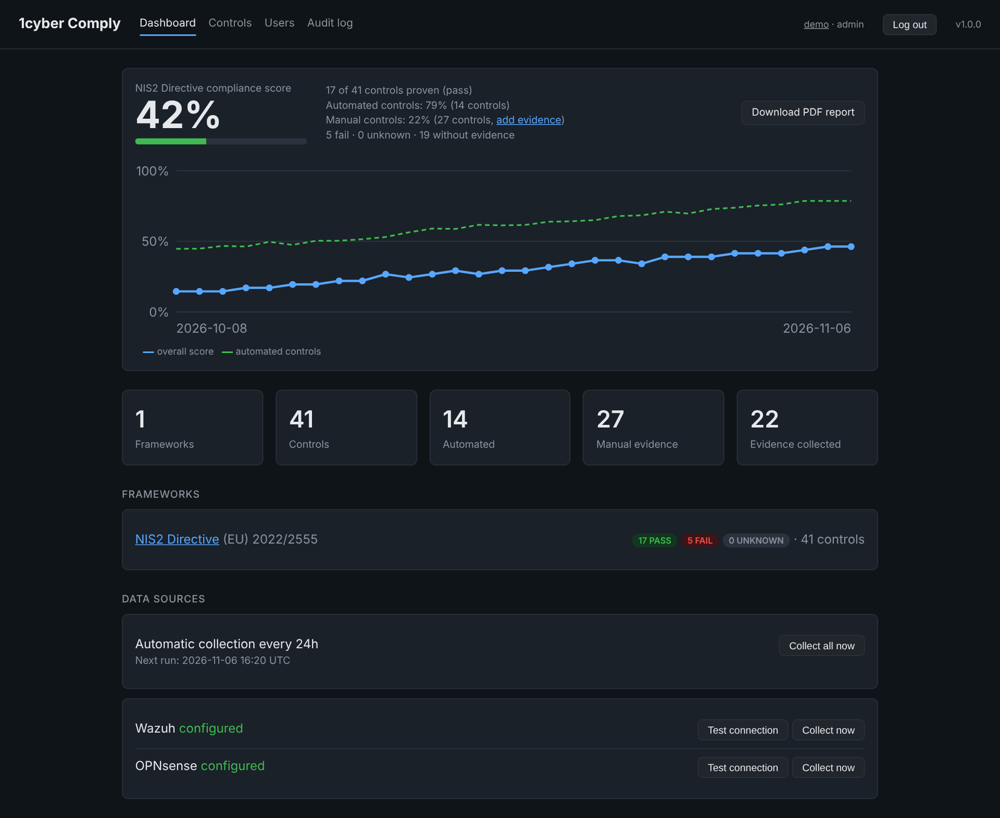
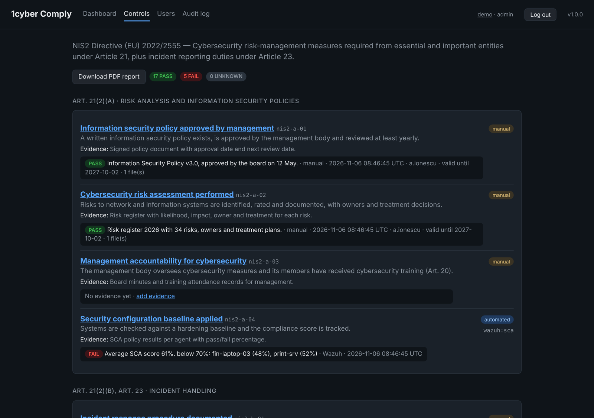
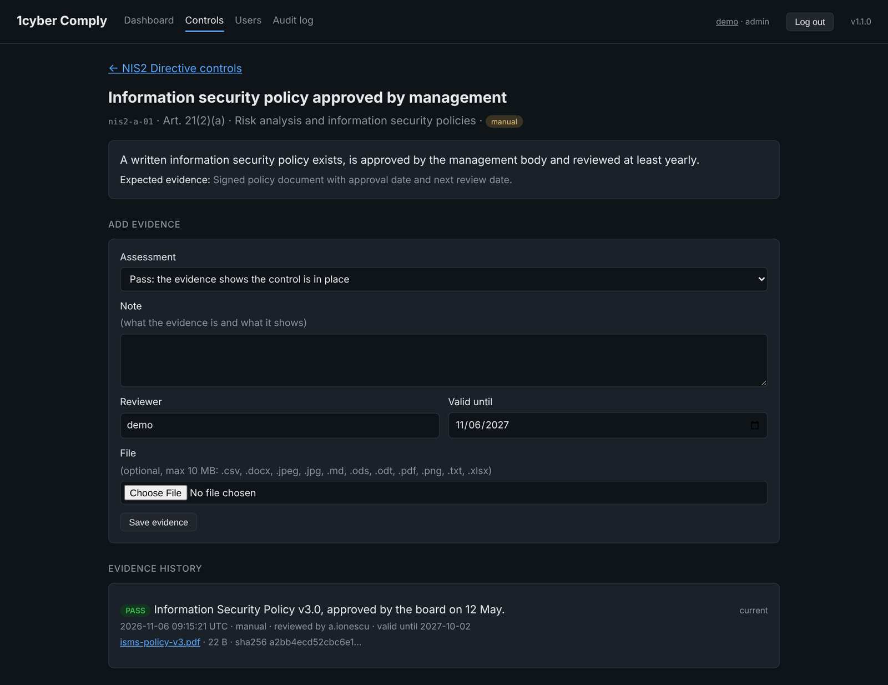
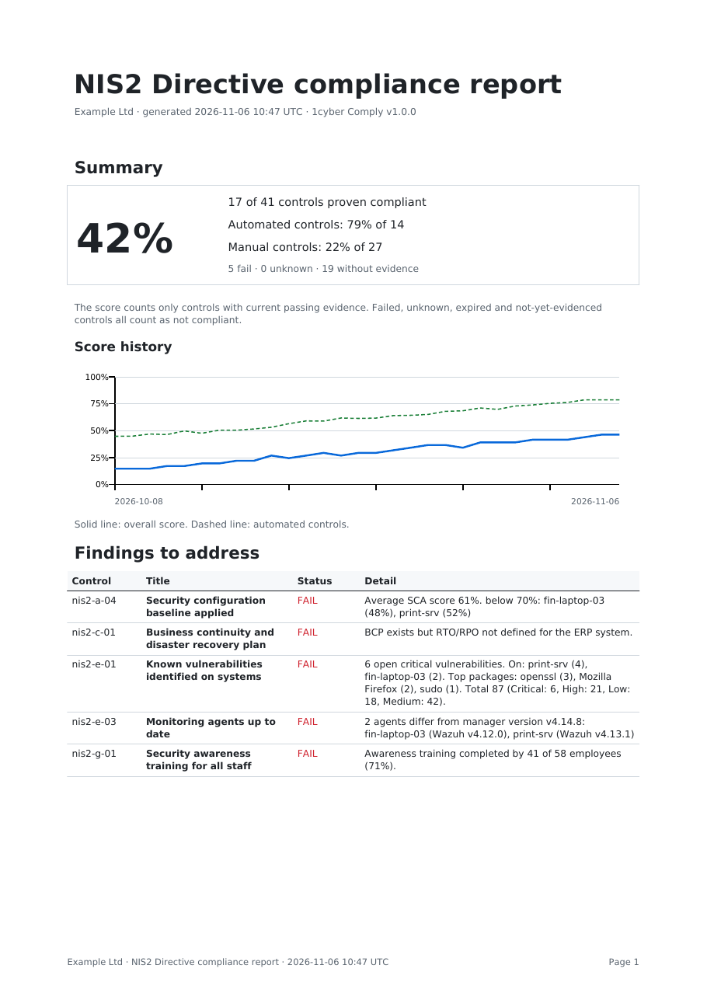

# 1cyber Comply

**Open-source NIS2 compliance automation for small and medium organisations.**

1cyber Comply connects to the security tools you already run, collects evidence with
read-only access, maps it to the NIS2 Article 21 controls and keeps a live compliance
score. What cannot be checked automatically (policies, training, contracts) is recorded
as manual evidence with an expiry date. One click turns it all into a PDF report for
management or auditors.

[](https://github.com/ilielucianno/1cyber-comply/actions/workflows/ci.yml)




## Why

NIS2 requires thousands of mid-sized EU organisations to prove their cybersecurity
measures. Commercial compliance platforms typically cost five figures per year.
1cyber Comply does the core of that job for free, on your own server, using tools many
teams already have: **Wazuh**, **OPNsense** and **Microsoft 365**.

## What it does

| | |
|---|---|
| **41 NIS2 controls** | Article 21(2)(a)–(j) and Article 23, each broken down into checks you can actually verify |
| **17 automated checks** | Wazuh: agents, versions, CIS hardening (SCA), file integrity, inventory, alerts, vulnerabilities by host and package. OPNsense: firmware currency, active firewall ruleset, IDS/IPS, VPN, HTTPS admin, VLAN segmentation. Microsoft 365: MFA enforcement and coverage, admin accounts, unused accounts. Plus a check that monitoring itself keeps running |
| **Manual evidence** | On any control: pass/fail assessment, note, file, reviewer and validity date. Expired evidence turns red automatically. Combines with automated sources |
| **Compliance score** | Only proven controls count. History chart, collection every 24 h |
| **PDF report** | Score, findings to fix, every control with its evidence, file hashes |
| **Cyprus DSA maturity model** | K.D.P. 245/2024 Annex E: 70 measures, 1,499 requirements, levels 0-5, English translation. Assessment screens, blocking requirement per measure, 23 requirements backed by automated evidence, PDF report with a remediation plan to level 3 |
| **Built for audits** | Roles (viewer / editor / admin), audit log of every action, evidence history per control |
| **Read-only by design** | Never changes anything on your systems. Minimal privileges documented below |

**Works with:** Wazuh, OPNsense and Microsoft 365 / Entra ID today; Zenarmor, Microsoft
Defender, FortiGate, Sophos, CrowdSec and Proxmox are planned. Any other tool can be covered
with manual evidence. See the full list in [INTEGRATIONS.md](INTEGRATIONS.md).

<table>
<tr>
<td></td>
<td></td>
<td></td>
</tr>
<tr>
<td align="center">Controls with live evidence</td>
<td align="center">Manual evidence and history</td>
<td align="center">PDF report</td>
</tr>
</table>

## Install

Requirements: Ubuntu or Debian, 1 GB RAM free, network access to Wazuh / OPNsense.
Docker is installed for you if missing.

**One-line installer** (install and upgrade):

```bash
curl -fsSL https://raw.githubusercontent.com/ilielucianno/1cyber-comply/main/get.sh | sudo bash
```

It installs into `/opt/1cyber-comply`, enables HTTPS with a self-signed certificate and keeps
your settings and data on every upgrade. [Read the script](get.sh) first; it is short.

**Debian package:** download the `.deb` from the latest
[release](https://github.com/ilielucianno/1cyber-comply/releases), then:

```bash
sudo apt install ./1cyber-comply_*_all.deb
```

`apt remove 1cyber-comply` stops it and keeps settings and data;
`apt purge 1cyber-comply` deletes them.

**From source:**

```bash
git clone https://github.com/ilielucianno/1cyber-comply.git
cd 1cyber-comply && ./install.sh
```

Open `https://<server>:8080` and create the administrator account.
Connection settings live in `/opt/1cyber-comply/.env`; after editing, apply them with
`cd /opt/1cyber-comply && sudo docker compose up -d --force-recreate`.

**Just want to look around?** Fill a database with fictional demo data:

```bash
COMPLY_DATA_DIR=/tmp/comply-demo python scripts/seed_demo.py
COMPLY_DATA_DIR=/tmp/comply-demo uvicorn app.main:app --port 8080   # log in: demo / Try-Comply-2026
```

## Connecting Wazuh

Create a dedicated API user with the built-in `readonly` role and set in `.env`:

```
WAZUH_URL=https://wazuh.example.local:55000
WAZUH_USER=comply
WAZUH_PASSWORD=...
```

Alerts and vulnerabilities live in the Wazuh Indexer (Wazuh 4.8+). Add a second user with
read access to `wazuh-alerts-*` and `wazuh-states-vulnerabilities-*` only:

```
WAZUH_INDEXER_URL=https://wazuh.example.local:9200
WAZUH_INDEXER_USER=comply_ro
WAZUH_INDEXER_PASSWORD=...
```

**Wazuh on the same machine (all-in-one install).** The Indexer usually listens only on
`127.0.0.1`, which a container cannot reach. Enable host-network mode in `.env`:

```
COMPOSE_FILE=docker-compose.yml:docker-compose.hostnet.yml
WAZUH_URL=https://127.0.0.1:55000
WAZUH_INDEXER_URL=https://127.0.0.1:9200
```

## Connecting OPNsense

OPNsense has no read-only API role, so 1cyber Comply only sends GET requests and asks for the
smallest privilege set possible. Create a user **without** group membership and assign only:

| Privilege | Used for |
|---|---|
| Lobby: Dashboard | installed version (firmware check) |
| Diagnostics: Firewall Statistics | active pf ruleset, legacy and new rule engines |
| Services: Intrusion Detection | IDS/IPS enabled and running |
| VPN: WireGuard (Configuration, Status) | remote access VPN |
| Interfaces: VLAN | network segmentation |

Do **not** grant `System: Firmware`, `Diagnostics: Backup & Restore` or
`Diagnostics: Configuration History`: they allow updates, full configuration download or restore.
Firmware currency is checked against the latest public OPNsense release on GitHub instead
(`OPNSENSE_CHECK_LATEST=false` on offline networks). Create the API key under
System → Access → Users and set `OPNSENSE_URL`, `OPNSENSE_KEY`, `OPNSENSE_SECRET` in `.env`.

## Connecting Microsoft 365

Register a read-only app in Entra ID, grant the Graph application permissions `User.Read.All`,
`Policy.Read.All`, `RoleManagement.Read.Directory` and `AuditLog.Read.All` (plus
`UserAuthenticationMethod.Read.All` without Entra ID P1), and set `M365_TENANT_ID`,
`M365_CLIENT_ID`, `M365_CLIENT_SECRET` in `.env`. Step by step:
[docs/microsoft365-setup.md](docs/microsoft365-setup.md).

## How the score works

The score is the share of controls with **current passing evidence**. Failed, unknown,
expired and not-yet-evidenced controls all count as not compliant, so the score never claims
more than has been proven. A snapshot is stored after every collection; collection runs every
`COLLECT_INTERVAL_HOURS` (default 24).

The report states clearly that it supports, but does not replace, an assessment by the
competent authority or an accredited auditor. It is not a certification.

## Maturity models (Cyprus DSA)

Some national authorities assess NIS2 with a maturity model instead of pass/fail. 1cyber
Comply ships the Cyprus Digital Security Authority (DSA) model from K.D.P. 245/2024 Annex E
(`controls/maturity/dsa-cy-245-2024.yaml`); each authority's framework is its own catalogue.

- **Scoring.** Levels are cumulative. A measure reaches a level only when every requirement
  of that level and of all lower levels is met; the first unmet requirement is the blocking
  requirement and caps the measure (1.3 not met means level 0, even if level 3 is met).
  Unassessed requirements count as not met. The organisation is mature when every measure
  is at level 3 or higher.
- **Not applicable** is accepted only where the catalogue allows it: for the DSA model, the two
  requirements that apply only when cloud services are used (DS1 4.9, HRS6 5.4). It needs a
  justification and is reported in a Cloud section.
- **Automated evidence** (`controls/maturity/evidence/`) links 23 requirements to Wazuh,
  OPNsense and Microsoft 365 checks. Evidence suggests answers but never overwrites the
  assessor; most links are "partial" and can only point out a gap. Saved answers that the
  current evidence contradicts are flagged as conflicts.
- **Report.** `/reports/maturity/dsa-cy-245-2024.pdf`: verdict, levels per category and
  measure, blocking requirements, a prioritised remediation plan to level 3, the Cloud
  section, evidence conflicts and the full assessment record.

The English text is an unofficial translation, read through by a Cyprus cybersecurity
practitioner; the Greek text in the Official Gazette prevails.

## Users and security

| Role | Can |
|---|---|
| viewer | read everything, download reports and evidence files (management, auditors) |
| editor | viewer + add evidence, run collections |
| admin | editor + test connections, manage users, read the audit log |

- Passwords hashed with scrypt, minimum 12 characters; one-time temporary passwords for new users
- Server-side sessions, revoked on logout, password change or when a user is disabled
- Lockout after 5 failed logins; CSRF protection on every change; SameSite=Strict cookies; strict CSP
- Uploaded files stored under random names and only served as downloads; SHA-256 recorded
- Evidence always attributed to the logged-in user; logins, uploads, collections and user changes audited

Expose the app beyond `127.0.0.1` only with HTTPS on (`COMPLY_TLS=true`, the installer default):
change the port binding in `docker-compose.yml` from `127.0.0.1:8080:8080` to `8080:8080`.

**Locked out?**
```bash
sudo docker exec -it 1cyber-comply python -m app.cli reset-password <username>
```

Report vulnerabilities privately: see [SECURITY.md](SECURITY.md).

## Configuration

All settings are environment variables in `.env`; see [.env.example](.env.example) for the full
list with comments (thresholds, collection interval, HTTPS, session and lockout settings,
organisation name on reports).

## Architecture

```
app/
  main.py            routes and UI
  guard.py           login, roles and CSRF on every request
  auth.py            users, scrypt, sessions, lockout, audit log
  collectors/        wazuh.py, opnsense.py, microsoft365.py, comply.py - one module per source
  evidence.py        stores results as evidence on controls
  scoring.py         compliance score, history, chart
  manual.py          manual evidence and file uploads
  report.py          PDF report (ReportLab)
  maturity.py        maturity models: catalogue, scoring, answers, automated evidence
  maturity_report.py maturity PDF report with remediation plan
  scheduler.py       automatic collection
controls/nis2.yaml   control catalogue - add a framework by adding a YAML file
controls/maturity/   maturity models (Cyprus DSA) and their automated evidence links
tests/               140 tests, Wazuh, OPNsense and Microsoft Graph simulated, no network needed
```

Stack: Python 3.12, FastAPI, SQLite, Jinja2, ReportLab, Docker. All dependencies use
permissive licences (MIT, BSD, Apache-2.0); nothing requires a commercial licence.

## Development

```bash
python3 -m venv .venv && source .venv/bin/activate
pip install -r requirements.txt pytest
pytest -q
uvicorn app.main:app --reload --port 8080
```

See [CONTRIBUTING.md](CONTRIBUTING.md). Ideas on the roadmap: ISO 27001 and DORA catalogues,
Zenarmor and Proxmox collectors, evidence reminders by email.

## Support and services

1cyber Comply is free and open source. Installation, configuration, NIS2 gap assessments and
custom collectors are available as professional services from [1cyber.eu](https://1cyber.eu).

## Licence

[Apache License 2.0](LICENSE). The NIS2 control descriptions are original wording based on
Directive (EU) 2022/2555, which may be reused freely under Commission Decision 2011/833/EU.
